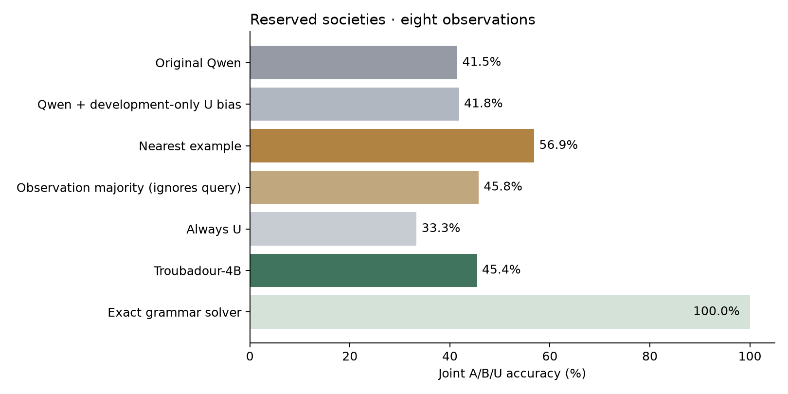

---
language:
- en
license: apache-2.0
library_name: mlx
base_model: mlx-community/Qwen3-4B-Instruct-2507-4bit
base_model_relation: adapter
datasets:
- noahmclaughlin/Troubadour
tags:
- mlx
- lora
- qwen3
- synthetic
- in-context-learning
- research
---
# Troubadour-4B

**Can post-training teach a model street smarts so that it can learn and apply unfamiliar social rules?**

**Negative research result:** this checkpoint did not pass all six primary criteria. It is published for inspection and reproduction, not as a demonstrated improvement in street smarts.

Troubadour-4B is an MLX LoRA adapter for a pinned, four-bit Qwen3-4B-Instruct-2507 base. It practices a controlled form of “street smarts”: infer fictional conventions from examples, apply them to a new encounter, and recognize when the examples leave the answer unresolved. This is a finite symbolic task in social language, not evidence of real-world cultural competence.

[Source and benchmark](https://github.com/1999labs/troubadour-4b) · [Troubadour dataset](https://huggingface.co/datasets/noahmclaughlin/Troubadour) · [Full results](RESULTS.md) · [Worked example](EXAMPLE.md)

## What is included?

The `adapter/` folder contains the learned LoRA weights and MLX adapter configuration. The original Qwen architecture and base weights are required and are downloaded automatically by the supplied predictor. This is an adapter release, not a merged Transformers checkpoint or a GGUF file. Use the supplied MLX inference path on Apple silicon; direct `transformers.from_pretrained()` loading of this repository is not supported.

The base is a dense decoder-only transformer with 36 layers, hidden size 2,560, 32 attention heads, eight key/value heads, and a tied input/output embedding. Its quantization uses four-bit groups of 64. A parameter is a learned numerical setting; the frozen base retains roughly four billion such settings. LoRA adds small trainable matrices within selected layers instead of updating every base parameter.

The adapter contains 3,670,016 trainable parameters. The selected adapter uses the last 8 layers, rank 8, and MLX's literal LoRA scale 16.0. This scale is the value passed to MLX, not an inferred alpha/rank convention. The exact training configuration is `configs/choice-slow-seed17.yaml` in the source repository.

## Measured result

| Primary reserved test | Accuracy |
|---|---:|
| Original Qwen | 41.5% |
| Troubadour-4B | 45.4% |
| Qwen with development-fitted U bias | 41.8% |
| Nearest-example heuristic | 56.9% |
| Query-blind observation majority | 45.8% |

The paired gain is +3.9 percentage points, with a society-clustered 95% bootstrap interval of [-1.3, +9.5] points. There are 306 episodes from 51 reserved complementary society pairs. The interval does not measure variation across training seeds.



Answerable accuracy changes from 33.3% to 62.7%; uncertainty recall changes from 57.8% to 10.8%. These must be considered together. The exact pass/fail criteria, transfer results, query-dependence stress test and exploratory evidence curves appear in [RESULTS.md](RESULTS.md) and [RESULTS.json](https://huggingface.co/noahmclaughlin/Troubadour-4B/blob/main/RESULTS.json).

## Run locally

The measured environment was Python 3.12.15 on an Apple M2 with 16 GiB unified memory. MLX handles local Apple GPU compute. No inference API key or paid cloud service is needed.

```bash
python3.12 -m venv .venv
source .venv/bin/activate
pip install huggingface-hub==2.4.0
hf download noahmclaughlin/Troubadour-4B --local-dir troubadour-release
cd troubadour-release
pip install -c requirements.lock -r requirements.txt
python -m troubadour.predict --adapter adapter --episode example_episode.json
```

The supplied example contains only `observations` and `query`. The predictor loads the original pinned Qwen checkpoint, applies the adapter, and reports the most likely A/B/U token plus normalized probabilities. A means respect, B means breach, U means insufficient evidence. Those probabilities are not calibrated confidence estimates. The published predictor does not apply the optional development-fitted bias. No extra reasoning tokens or tool-assisted inference are used in the benchmark.

To compare original Qwen on the same example, omit `--adapter adapter`. To open the optional local demo, install `gradio` using the same constraints and run `python app.py --adapter adapter`. The demo binds to localhost, and random demo worlds may overlap training rules. It is not the held-out evaluation.

The base weights require several gigabytes of download/storage and additional working memory. Exact revision: `50d427756c6b1b2fe0c0a10f67fbda1fc8e82c1b`. This release has not been validated on CUDA or other non-MLX runtimes.

## Post-training and evaluation

Training is supervised classification over the model's original A/B/U next-token logits. It is not reinforcement learning, an external classifier head, or a symbolic solver disguised as the model. Only observed encounters and the query enter neural inference; hidden rules, correct answers and surviving-rule counts are excluded. The exact reference solver supplies training labels and evaluation judgments.

The dataset generator enumerates 612 unique Boolean conventions over five binary encounter features. Whole rule identities and their complements are separated across training, development and final evaluation. A second test reserves combinations of relevant features. Final encounters were generated only after the development-selected adapter, recipe, scorer and calibration settings were frozen.

The selected training pool was the `train_choice` dataset split: 2,850 distinct eight-observation episodes, balanced across A/B/U. The retained checkpoint processed 2,400 example presentations in 300 optimizer updates. Pool size and processed presentations are different quantities; an early checkpoint may not have seen the whole pool. The full `train` split and the alternative training views overlap and must not be counted as independent examples.

Selected recipe: `choice-slow-seed17`. Seed: 17. Selected microstep: 1200. See [selection.json](https://huggingface.co/noahmclaughlin/Troubadour-4B/blob/main/selection.json) for SHA-256 identities and the recorded selection reason. `final_data_seen: false` records the state at selection time; final evaluation was subsequently performed.

Frozen lower-layer activations are cached during some training/evaluation runs to avoid recomputing unchanged work. This preserves the original model computation; it adds no oracle features and contains no future answer tokens. Full/cached inference probabilities and the separate training-objective gradients were checked on small audit cases. Release scoring uses protocol v4: one unpadded input and the full output projection. Earlier development scoring was corrected after a low-precision projection discrepancy, and selection was rerun before the reserved test. The released predictor uses the full model with its adapter and does not need the activation cache.

Measured training durations and retained update/token counts are in [COMPUTE.md](COMPUTE.md). Memory limits are recorded as limits, not measured peaks.

## Limits

Only one training seed was evaluated for release. Independent-seed replication and the planned budget-matched answer-key training control were not completed. Development involved multiple trials, so its scores are not confirmatory. The small evidence/rendering/smoke diagnostics do not establish broad generalization or preserved general chat ability.

This model is intended for reproducing the experiment and learning about post-training. It is not evaluated for interpreting real communities, deciding what behavior is socially acceptable, or making decisions about people. The rules and their labels are fictional. The exact symbolic solver is stronger by construction on this known finite grammar, and the nearest-example heuristic is reported transparently.

A public test can be contaminated by later training. Future comparisons should disclose data use and reserve genuinely unseen societies. We do not claim to invent in-context learning or synthetic rule induction; relevant prior work and all failed trials are documented in the source repository.

## License

Original adapter weights, source code and synthetic data: Apache-2.0. Qwen base-model ownership and its upstream Apache-2.0 license remain unchanged. See [LICENSE](LICENSE), [NOTICE](NOTICE), [RESEARCH_PLAN.md](RESEARCH_PLAN.md), and [EXPERIMENT_LOG.md](EXPERIMENT_LOG.md).
