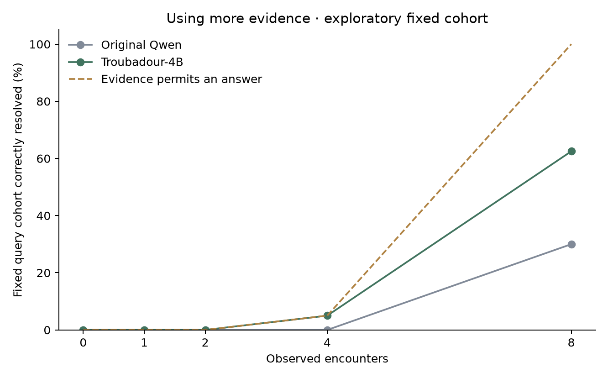

# Troubadour-Bench results

The selected checkpoint did not meet all six predeclared primary criteria. This is a research checkpoint, not a validated improvement in street smarts.

**Can post-training teach a model street smarts so that it can learn and apply unfamiliar social rules?**

Here, street smarts means inferring fictional conventions from examples and recognizing when the evidence does not determine an answer. These results concern a finite Boolean rule system expressed in social language. They do not establish real-world cultural competence.

The primary test contains 306 episodes from 51 reserved complementary society pairs. Each model receives eight observations and chooses A (respect), B (breach), or U (insufficient evidence). We selected the adapter using development data and froze its checksum before generating any final encounters.

| Method | Joint accuracy | Answerable accuracy | Uncertainty recall |
|---|---:|---:|---:|
| Original Qwen | 41.5% | 33.3% | 57.8% |
| Qwen + development-only U bias | 41.8% | 61.8% | 2.0% |
| Nearest example | 56.9% | 76.5% | 17.6% |
| Observation majority (ignores query) | 45.8% | 62.7% | 11.8% |
| Always U | 33.3% | 0.0% | 100.0% |
| Troubadour-4B | 45.4% | 62.7% | 10.8% |
| Exact grammar solver | 100.0% | 100.0% | 100.0% |

Troubadour's gain over raw Qwen is **+3.9 percentage points**, with a paired society-clustered 95% bootstrap interval of [-1.3, +9.5] points (10,000 resamples). This interval reflects uncertainty over sampled societies, not over independent training seeds.

Answerable accuracy includes abstentions as errors on determinate A/B questions. Uncertainty recall measures how often the model correctly says U on underdetermined questions. The three labels are balanced by design; this is not a natural population frequency estimate.

## Frozen success criteria

| Criterion | Result |
|---|---|
| At least +10 points over raw Qwen | Fail |
| Paired cluster interval entirely above zero | Fail |
| At least +10 points answerable accuracy | Pass |
| Uncertainty recall drops no more than 10 points | Fail |
| At least +5 points over development-calibrated Qwen | Fail |
| Positive gain on structural transfer | Pass |

All six must pass. These thresholds were not changed after final testing. The unadjusted adapter remains the primary model.

## Transfer and query dependence

| Test | Episodes | Qwen | Troubadour | Paired gain (95% cluster interval) |
|---|---:|---:|---:|---|
| Unseen rule identities | 306 | 41.5% | 45.4% | +3.9 [-1.3, +9.5] points |
| Reserved feature combinations | 150 | 36.7% | 40.7% | +4.0 [-5.3, +13.3] points |
| Opposite-query stress | 204 | 28.4% | 53.4% | +25.0 [+19.1, +30.9] points |

On the stress test, getting both opposite queries right occurs for 5.9% of query pairs for Qwen and 13.7% for Troubadour. These pairs share observations and require different answers, so observation-only guesses cannot solve both. This is a selected stress distribution, not the same distribution as the primary test.

On this stress distribution, conditional A/B accuracy is 59.3% for Qwen and 59.8% for Troubadour when U is ignored. This comparison helps distinguish fewer abstentions from better A/B ordering; a large joint-accuracy gain alone is insufficient evidence of improved query reasoning.

## Calibration diagnostics

The U-logit biases fitted on development data were -4.00 for Qwen and +0.00 for the selected adapter. Applied unchanged to the final test, the adjusted accuracies are 41.8% and 45.4%. These are secondary comparisons; the deployed predictor uses the unadjusted model.

When U is ignored solely to compare the relative A/B scores on answerable questions, accuracy is 64.7% for Qwen and 74.5% for Troubadour. U-versus-best-A/B ranking AUC is 0.488 and 0.461, respectively. AUC 0.5 means chance ranking. These metrics cannot by themselves replace joint accuracy or safe abstention.

## Evidence curves and rendering checks

The fixed first 60 reserved episodes are checked at 0, 1, 2, 4 and 8 observations. The plot focuses on queries answerable at eight observations, and credits a correct resolution only when the current evidence justifies it. Perfect U accuracy at zero observations is trivial and is not called successful learning.

The resulting fixed cohort contains 40 queries. The table below tracks answering A/B when the current observations still do not justify either answer. The denominator contains only queries unresolved at that prefix. At eight observations none remain unresolved, by the cohort definition. These percentages therefore describe premature certainty on the shorter prefixes, not the primary test's eight-observation uncertainty recall.

| Observations | Still unresolved in the fixed cohort | Qwen unjustified certainty | Troubadour unjustified certainty |
|---|---:|---:|---:|
| 0 | 40 | 0.0% | 0.0% |
| 1 | 40 | 2.5% | 5.0% |
| 2 | 40 | 55.0% | 55.0% |
| 4 | 38 | 63.2% | 89.5% |
| 8 | 0 | not applicable | not applicable |

| Rendering (first 48 reserved episodes) | Qwen | Troubadour |
|---|---:|---:|
| prose | 33.3% | 41.7% |
| symbols | 33.3% | 43.8% |

These small, prospectively bounded subsets are exploratory. Their scores do not establish broad robustness.

The 12 simple general-instruction smoke checks passed 11/12 for Qwen and 11/12 for Troubadour. This is too small to claim general capabilities were preserved.

## Scope and reproducibility

Published seed: 17. Selected recipe: `choice-slow-seed17` at microstep 1200. The exact weight, recipe, data, renderer and runtime identities are in `results/selection.json` in GitHub and `selection.json` in the Hub releases. Failed and weaker trials are retained in [EXPERIMENT_LOG.md](EXPERIMENT_LOG.md).

This first release is exploratory and uses one training seed. Independent-seed replication and the prepared budget-matched answer-key training control were not completed. Therefore neither a positive result nor a negative result establishes a general conclusion about post-training, a neural learning mechanism, or other model sizes. Repeated development comparisons also make development scores unsuitable as final evidence.

Test data is public after evaluation. Future models may train on it; subsequent claims should disclose this and use genuinely held-out societies. The exact grammar solver is a transparent reference, not part of the neural predictor.
